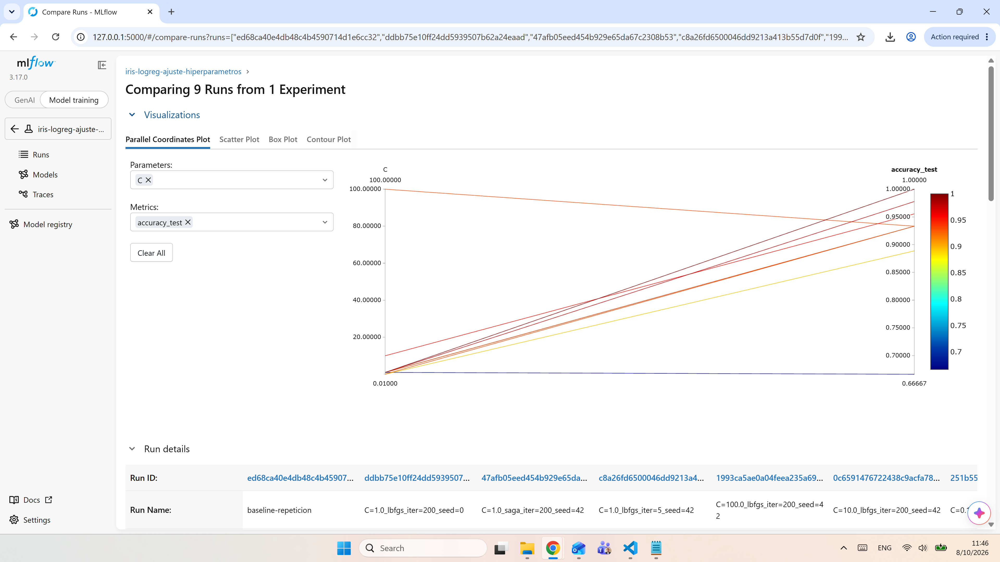

# Análisis de resultados: experimento `iris-logreg-ajuste-hiperparametros`

Se ejecutaron 9 corridas de una Regresión Logística sobre Iris (149 registros, 45 en prueba), variando `C`, `max_iter`, `solver` y la semilla.

| # | C | solver | max_iter | seed | Acc. train | Acc. test | F1 macro | Acc. CV | ¿Convergió? |
|---|---|---|---|---|---|---|---|---|---|
| 1 | 1 | lbfgs | 200 | 42 | 0.971 | 0.933 | 0.933 | 0.962 | Sí |
| 2 | 0.01 | lbfgs | 200 | 42 | 0.885 | 0.889 | 0.888 | 0.875 | Sí |
| 3 | 0.1 | lbfgs | 200 | 42 | 0.962 | 0.933 | 0.933 | 0.942 | Sí |
| 4 | **10** | **lbfgs** | **200** | **42** | **0.990** | **0.956** | **0.955** | **0.962** | **Sí** |
| 5 | 100 | lbfgs | 200 | 42 | 1.000 | 0.933 | 0.933 | 0.971 | Sí |
| 6 | 1 | lbfgs | 5 | 42 | 0.683 | 0.667 | 0.556 | 0.750 | No |
| 7 | 1 | saga | 200 | 42 | 0.981 | 0.978 | 0.978 | 0.981 | No |
| 8 | 1 | lbfgs | 200 | 0 | 0.942 | 1.000 | 1.000 | 0.932 | Sí |
| 9 | 1 | lbfgs | 200 | 42 | 0.971 | 0.933 | 0.933 | 0.962 | Sí |

**Mejor configuración: C = 10 con lbfgs (corrida 4).** Tiene el mejor accuracy de prueba entre las corridas que convergieron con la misma división de datos (0.956), y su validación cruzada (0.962) está entre las más altas. C = 100 logra la validación cruzada más alta (0.971), pero en prueba se queda en 0.933 y llega a 100 % en entrenamiento, señal de que empieza a memorizar. No se consideran la corrida con `saga` (0.978), porque llegó al límite de iteraciones sin converger, ni la de semilla 0 (1.000), porque se evaluó con otras flores de prueba. Aun así, la ventaja de C = 10 sobre el baseline es de una sola flor.

**Hiperparámetro más influyente: `C`.** De C = 0.01 a C = 10, el accuracy de prueba sube de 0.889 a 0.956 y la validación cruzada de 0.875 a 0.962. Con C = 0.01 la regularización es tan fuerte que el modelo subajusta; a partir de C ≈ 10 los resultados ya no mejoran de forma consistente. `max_iter` tuvo el efecto más drástico (con 5 iteraciones el modelo nunca predice *virginica*), pero es una configuración defectuosa: una vez que alcanza para converger, no cambia el resultado. El `solver` no debería influir, porque el problema tiene una única solución óptima; `saga` difiere solo porque no convergió.

**Reproducibilidad.** La corrida 9 repite los argumentos de la 1 y obtiene métricas idénticas.

**Limitaciones.**
- Con 45 flores en prueba, cada error vale 2.2 puntos: las diferencias entre configuraciones son de una o dos flores y no son concluyentes.
- La semilla pesa tanto como los hiperparámetros: con la configuración del baseline, cambiarla de 42 a 0 movió el accuracy de prueba de 0.933 a 1.000, aunque su validación cruzada bajó a 0.932. Conviene decidir con validación cruzada o con varias semillas.
- Las variables no están escaladas, lo que hace lento a `saga`; el siguiente experimento sería agregar un `StandardScaler`.
- Se probó una sola familia de modelos, con búsqueda manual, en un dataset limpio y fácil.

